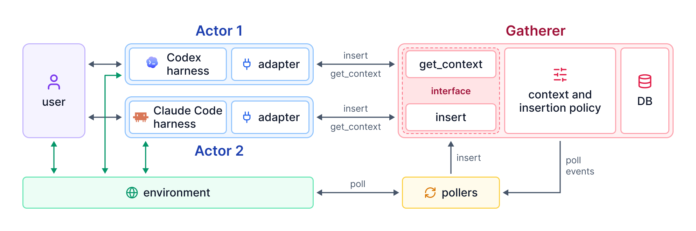

# Documentation

## Overview {#overview}

Actor-Gatherer is a framework for agent design where agents context is managed proactively and externally using a Gatherer component. `ag` is a cli tool that turns any coding agent (Claude Code, Codex, OpenCode or Pi) into an actor-gatherer agent. The agent performing your tasks is called an Actor, and a **Gatherer** component manages the context of all actors connected to it. The Actors share all their messages with the Gatherer, and before every LLM call, they ask the Gatherer for their context. The Gatherer decides the context the model gets based on the current conversation, plus what matters from earlier history, from other agents, and from the environment.

<figure class="wide full"><figcaption>Each Actor (a harness and its adaptor) sends what it sees and does to the Gatherer, and gets its context back before each model call. Pollers bring in changes from the environment, and the Gatherer's policy decides what context each Actor gets.</figcaption></figure>

The **Gatherer** is a server that many **Actors** talk to, and the Actors can come from different coding harnesses. An Actor is a harness plus its **adaptor**, which turns the harness's messages into events and the Gatherer's context back into messages. Each Actor uses two calls on the Gatherer:

- **`insert`** gives the Gatherer what the Actor has seen and done.
- **`get_context`** runs before each model call, and returns the context the model gets.

**Pollers** bring in information from the environment, such as files changed under the working directory. The Gatherer asks them for new events, and they insert those events like an Actor would. A **context management policy** inside the Gatherer then decides what context each Actor gets, using everything it has gathered from every Actor and from the environment.

`ag` currently uses:

- **Adaptors:** [`ClaudeAdaptor`](https://github.com/ucbepic/actor-gatherer/blob/main/ag/integrations/harnesses/claude/adaptor/adaptor.py), [`CodexAdaptor`](https://github.com/ucbepic/actor-gatherer/blob/main/ag/integrations/harnesses/codex/adaptor/adaptor.py), [`OpencodeAdaptor`](https://github.com/ucbepic/actor-gatherer/blob/main/ag/integrations/harnesses/opencode/adaptor/adaptor.ts) and [`PiAdaptor`](https://github.com/ucbepic/actor-gatherer/blob/main/ag/integrations/harnesses/pi/adaptor/adaptor.ts), each with the launcher `ag` uses to start that harness connected to the Gatherer.
- **Pollers:** [`FileChangePoller`](https://github.com/ucbepic/actor-gatherer/blob/main/ag/ag_pollers/file_changes.py), which reports files changed under the agent's working directory since it last looked.
- **Context Policy:** [`ProactiveContextManager`](https://github.com/ucbepic/actor-gatherer/blob/main/ag/ag_policies/proactive_context_manager/policy.py), which searches earlier history in the background, and adds what other sessions asked for and what changed in the environment.

The framework is extensible. Add a new harness by defining an adaptor for it, new context policies for context management, and pollers that track other information in the environment. See [Extending `ag`](#extending).

## Install {#install}

You need Python 3.11+ and the harness you want to run on your `PATH`. Install `ag` from PyPI:

```
pip install actor-gatherer
```

Or from source:

```
git clone https://github.com/ucbepic/actor-gatherer && cd actor-gatherer
pip install -r requirements.txt        # `ag` from this clone, editable, with every dependency
```

**Then set the LLM the Gatherer uses.** It can be an API-based model, called through [LiteLLM](https://docs.litellm.ai/docs/providers). Name it as `provider/model`, and set that provider's API key:

```
ag model openai/gpt-6-sol                    # "provider/model"; the key from OPENAI_API_KEY
export OPENAI_API_KEY=...

ag model gemini/gemini-3.8-flash             # or a Gemini model; the key from GEMINI_API_KEY
export GEMINI_API_KEY=...
```

Or it can be a coding agent, such as Claude Code or Codex, which then runs for the Gatherer on its own login:

```
ag model claude-code/sonnet
ag model codex/gpt-6-sol
```

To use Codex, make sure OpenAI's Codex SDK is installed (`ag` refuses to run with a `codex/` model until it is):

```
pip install openai-codex
```

To check the model that is set:

```
ag model
```

## Quickstart {#quickstart}

Put `ag --gatherer NAME` in front of the agent command you would normally run:

```
ag --gatherer demo claude                                # Claude Code
ag --gatherer demo codex exec "fix the tests"            # Codex
ag --gatherer demo opencode run "add a --verbose flag"   # OpenCode
ag --gatherer demo pi                                    # Pi
```

Agents join the gatherer named (`demo` above). Agents in the same gatherer share information with each other, whichever harness runs them. Agents in different gatherers don't share context, and each gatherer keeps its own history.

For example, the first two agents below share information; the third, in a gatherer of its own, sees neither of them:

```
ag --gatherer frontend claude                            # shares with the Codex below
ag --gatherer frontend codex                             # shares with the Claude Code above
ag --gatherer backend codex                              # shares with neither
```

Without `--gatherer`, a session joins the gatherer `default`:

```
ag codex                                                 # the same as: ag --gatherer default codex
```

Use `--gatherer .` to create a new, unnamed gatherer. Agents created this way don't share context with other agents:

```
ag --gatherer . codex
```

To see every gatherer:

```
ag gatherers                                             # each one's policy, pollers, event count, last activity
```

Every option and command is in [`ag` CLI interface](#cli).

## `ag` CLI interface {#cli}

`ag` is the command line that runs a harness with the Gatherer, and manages the gatherers and settings it keeps. Its options go before the harness's name, and everything after the name is passed to the harness unchanged.

### Options {#options}

By default every agent you start with `ag`, from any harness, joins one shared gatherer named `default` ([`[cli] gatherer`](#cli-settings)), each session as its own channel.

| flag | meaning |
|---|---|
| `--gatherer NAME` | Join the named gatherer, created if it does not exist. Overrides `[cli] gatherer`. |
| `--gatherer .` | Give each session a new gatherer of its own, named after the session. |
| `--policy P` | Create the gatherer with policy `P`. Refused if it exists with another policy. |
| `--poller X` | Create the gatherer with poller `X` (repeatable). |
| `--no-pollers` | Create the gatherer with no pollers. |
| `--dry-run` | Print the command and environment that would run, and run nothing. |

A new gatherer takes its policy and pollers from the defaults in `config.toml`, or from `--policy` and `--poller` when given. They are recorded in `~/.ag/gatherers/<name>/gatherer.toml`, where you can change an existing gatherer's pollers, or override its policy's options under `[options]`. A gatherer's policy cannot change once it is in use; to try another, start a new gatherer.

<p class="note">The gatherer is chosen on every model call; it is not stored with the session. To resume a session in a named gatherer, name it again: <code>ag --gatherer demo codex resume &lt;id&gt;</code>. Without <code>--gatherer demo</code>, the resumed session goes into <code>default</code>.</p>

### Commands {#commands}

| command | does |
|---|---|
| `ag <harness> [args]` | Run the harness with the Gatherer. |
| `ag model [NAME] [--api-base URL] [--key-env VAR]` | Show or set the LLM the Gatherer calls. |
| `ag config` | Show where the settings are, and what each harness resolves to. |
| `ag status` / `ag stop` | List / stop the proxies `ag` started. |
| `ag gatherers` | List every gatherer: its policy, pollers, events and last activity. |
| `ag show <gatherer>` | Show a gatherer's resolved settings. |
| <code>ag new &lt;gatherer&gt; [--policy P] [--poller X ... &#124; --no-pollers]</code> | Create a gatherer ahead of use. |
| `ag home list` | List every available policy and poller, and any problem. |
| `ag home path` | Print the home directory. |

### The home directory {#home}

Everything `ag` keeps is in one directory, `~/.ag` (set `AG_HOME` to move it). Each gatherer has a directory of its own, with its settings and its database:

```
~/.ag/
├── config.toml                     every setting: policies, pollers, the LLM, harnesses
├── plugins/                        your own policies and pollers (Python files)
├── gatherers/<name>/               one directory per gatherer:
│   ├── gatherer.toml               its policy, its options and its pollers
│   └── context.db                  its database (SQLite): every event, and every context it sent
├── hook_server/<port>.json         the proxies ag started (Claude Code, Codex)
└── logs/
    ├── gatherers/<name>/server.log what each model call came to
    ├── gatherers/<name>/worker.log the gatherer's background builds
    ├── <harness>_server.log        each Gatherer server's own output
    ├── hook_servers/<port>.log     each proxy's output
    └── llm/                        one JSON file per LLM call the policies make
```

A gatherer's database records exactly what the model was sent on every call, so any context can be audited later. `ag gatherers` lists every gatherer, and `ag show <gatherer>` shows one's settings.

## Configuration {#configuration}

Every setting is in `~/.ag/config.toml`, created the first time you run `ag` with every default written out. A command-line option overrides the setting it names (`--gatherer` over `[cli] gatherer`), and so does an `AG_*` environment variable (`AG_LLM_MODEL` over `[policies.llm] model`). The file has these tables:

```
[policies]                     # the default policy
[policies.llm]                 # the LLM the policies call
[policies.available.<name>]    # the catalog: every policy a gatherer may use

[pollers]                      # the default pollers
[pollers.available.<name>]     # the catalog: every poller a gatherer may use

[cli]                          # the ag command: the default gatherer
[cli.harnesses.<name>]         # each harness ag can run
```

`ag config`, `ag home list` and `ag show` show how the settings resolve (see [Commands](#commands)).

### `[policies]` {#policies}

```
[policies]
default = "proactive_context_manager"    # the policy a new gatherer gets when none is named

[policies.available.proactive_context_manager]
class = "ag.ag_policies.proactive_context_manager:ProactiveContextManager"

[policies.available.pcm_small]           # a variant: the same class, other options
class = "ag.ag_policies.proactive_context_manager:ProactiveContextManager"
options = { min_context_tokens = 5000, max_context_tokens = 40000 }

[policies.available.mine]                # your own, from ~/.ag/plugins/mine.py
file = "mine.py"
class = "MyPolicy"
options = { show = 3 }
```

Each entry under `[policies.available.<name>]` makes a policy available under that name:

| key | meaning |
|---|---|
| `class` | `"module:Class"` for an importable class; or just `"Class"` together with `file` or `module`. A factory function works too. |
| `file` | A Python file in `~/.ag/plugins/` that defines `class`. |
| `module` | An importable module that defines `class`. |
| `options` | Options passed to the policy. A gatherer's own `[options]` in its `gatherer.toml` are applied on top of these. |

Two entries can name the same class with different options; each is a separate policy, and a gatherer picks one by name (`ag --gatherer small --policy pcm_small codex`).

### `[policies.llm]` {#llm}

The LLM the policy calls (to split history into tasks, summarize them, and rank them). There is no default model; set one here or with [`ag model`](#commands). The model's name decides how it is called:

- **A coding agent**, `claude-code/<model>` or `codex/<model>` (e.g. `claude-code/sonnet`): runs Claude Code (`claude -p`) or Codex for each call, on that agent's own login, with its tools and default instructions out of the way. No API key is needed, and every call counts against the subscription's limits. Codex models need OpenAI's Codex SDK: `pip install openai-codex`; `ag` refuses to run without it.
- **Any other name**, `provider/model` (e.g. `gemini/gemini-3.8-flash`): called through [LiteLLM](https://docs.litellm.ai/docs/providers), with the provider's API key.

```
[policies.llm]
model = "gemini/gemini-3.8-flash"        # required: claude-code/<model>, codex/<model>, or "provider/model" for LiteLLM
# api_base = "http://127.0.0.1:4011/v1"  # LiteLLM: send every call to a LiteLLM proxy or another OpenAI-compatible server
# key_env = "LITELLM_KEY"                # LiteLLM: read the key from this variable (default: the provider's own)
# claude_command = "claude"              # claude-code: the Claude Code to run
# codex_command = "codex"                # codex: the Codex to run
# log_prompts = true                     # also keep each call's full prompt in its log
```

| key | for | default | meaning | overridden by |
|---|---|---|---|---|
| `model` | all | none | The model, as above. Without one, `ag` warns at launch and every Gatherer call fails. | `AG_LLM_MODEL` |
| `api_base` | LiteLLM | the provider's | Send every call to this server instead. | `AG_LLM_URL` |
| `key_env` | LiteLLM | the provider's variable | The environment variable that holds the API key. | `AG_LLM_KEY` (the key itself) |
| `claude_command` | claude-code | `"claude"` | The Claude Code executable, found on `PATH`. |  |
| `codex_command` | codex | `"codex"` | The Codex executable, found on `PATH`. |  |
| `log_prompts` | all | `false` | Keep each call's system text and prompt, whole, in `~/.ag/logs/llm/`. Usage, timing and the answer are always logged. |  |
| `class` | your own | none | An LLM implementation of your own, named like a policy's `class` (with `file` or `module` if needed), instead of the two above. |  |

The Gatherer's own calls to Claude Code or Codex run without `ag`'s environment, so they never come back through `ag`.

### `[pollers]` {#pollers}

```
[pollers]
default = ["file_changes"]               # the pollers a new gatherer gets, whatever its policy

[pollers.available.file_changes]
class = "ag.ag_pollers.file_changes:FileChangePoller"
args = { root = "{cwd}" }

[pollers.available.team_chat]            # your own, from ~/.ag/plugins/chat_log.py
file = "chat_log.py"
class = "ChatLogPoller"
args = { path = "~/team-chat.jsonl", stream = "#team" }
```

An entry under `[pollers.available.<name>]` takes `class`, `file` and `module` as for policies, and `args`: the arguments the poller is built with. In a string argument, `{cwd}` is the agent's working directory, `{gatherer}` the gatherer's name and `{home}` the `ag` home; `~` is expanded. A poller whose arguments need `{cwd}` is skipped when the request has no working directory.

A gatherer's pollers must output event types its policy accepts; `ag` checks this before each run (see [Events, event types and properties](#events)).

### `[cli]` {#cli-settings}

```
[cli]
gatherer = "default"     # the gatherer every run joins; "." for one gatherer per session
```

`--gatherer` overrides it for one run (see [Options](#options)).

### `[cli.harnesses.<name>]` {#harnesses}

`ag` knows a harness only from its entry here, which names its launcher and its adaptor and holds the launcher's settings. `ag <name>` runs it. How each shipped harness is connected is in [The shipped harnesses](#connection-table).

<!-- gen: harness claude -->

| key | harnesses | default | meaning |
|---|---|---|---|
| `launcher` | all | (shipped) | The launcher class, `"module:Class"`. |
| `adaptor` | all | (shipped) | The adaptor class: `"module:Class"` in Python, or `"path.ts:Export"` in TypeScript (relative to the clone). |
| `command` | all | the harness's name | The command to run, as a list or a string. |
| `env` | all | `{}` | Extra environment variables for this harness only. |
| `port` | claude, codex | 4113 / 4013 | The first port the proxy tries. |
| `log_dir` | claude, codex | `""` | If set, write each request the hook changed, before and after. |
| `upstream` | claude | `""` | Where API calls go. Empty: `$ANTHROPIC_BASE_URL` if set, else Anthropic's API. |
| `trace_root` | claude | `""` | If set, record every model call there: the request as the model got it, and its answer. |
| `system_messages` | claude | `""` | How the Gatherer's messages are sent: `keep` (as system messages) or `user` (as user-turn reminders). Empty: chosen by model, `user` for Gemini. |
| `provider` | codex | `""` | The Codex model provider to hook. Empty: the one Codex would use. |

Environment variables for one harness, set when you run it:

| variable | harness | default | meaning |
|---|---|---|---|
| `AG_PI_TIMEOUT_MS`, `AG_OPENCODE_TIMEOUT_MS` | pi, opencode | 300000 | How long a model call waits for the Gatherer. |
| `AG_PI_COMPACTION=allow`, `AG_OPENCODE_COMPACTION=allow` | pi, opencode | off | Keep the harness's own compaction on. |
| `AG_CODEX_AG_ROLE=user` | codex | `developer` | Send the Gatherer's messages to Codex as user messages instead of developer messages. |

### Other environment variables {#env}

| variable | default | meaning |
|---|---|---|
| `AG_HOME` | `~/.ag` | The [home directory](#home): settings, gatherers, logs. |
| `AG_PYTHON` | `python3` | The Python that runs the Gatherer's server. The Claude Code and Codex proxies default to the Python they run in. |
| `AG_GATHERER` | none | The gatherer, for the Pi extension and the OpenCode plugin when run without `ag`. Ignored under `ag`: use `--gatherer`. |
| `AG_ADAPTOR` | set by `ag` | The adaptor the Pi extension or OpenCode plugin loads, as `"path.ts:Export"`. |

## Extending `ag` {#extending}

The framework is built to be extended in three places. A **context policy** decides what context each model call gets. A **poller** brings in information from the environment. An **adaptor**, with a launcher, connects a new harness. Each is a class you name in `config.toml`; nothing else in `ag` needs to change. Policies and pollers can live in `~/.ag/plugins/`, or in any importable package.

### Events, event types and properties {#events}

Everything the Gatherer stores is an **event**: a user message, the model's answer, a tool call, a tool's output, a file change. An event carries an opaque JSON *payload*, which the Gatherer stores and returns exactly as given, and has an *event type*. It may also carry an *id* (so a re-sent event is stored once), a *text* (what the policy reads of it, without the harness's metadata), and a token cost.

Event types are the contract between the three extension points. A policy declares the types it accepts; an adaptor and a poller each declare the types they output. `ag` refuses to run when an output is not among the policy's types. The types `proactive_context_manager` accepts are:

| type | events of this type |
|---|---|
| `user_message` | A request from the user; opens a turn. |
| `agent_message` | The model's answer. |
| `tool_call`, `tool_output` | A request to run a tool, and its result. |
| `context` | Text the harness puts in front of the model (instructions, injected context, compaction summaries). Kept verbatim. |
| `agent_reasoning` | The model's own reasoning: sent back as it was, never read or counted. |
| `environment_update` | Something in the environment changed. Payload: `subject` (what changed, named as the agent would name it), `what` (a sentence saying what happened), `timestamp`, `source`. |
| `context_stream` | A message from a stream the user is part of (a chat channel, a ticket). Payload: `stream`, `author`, `text`, `timestamp`. |

An event type also declares **properties**: named values its events carry beside the payload. Three are in use:

- `channel`: the session an event belongs to. The harness side sets it on every event and on every read. An event without a channel (such as a poller's) is visible from every channel.
- `cwd`: the agent's working directory, set from the request, and by the file poller to the directory it watched.
- `poller`: which of the gatherer's pollers an event came from (its name in the catalog).

Adaptors and pollers declare which properties they set, and `ag` also checks those against the policy's event types.

### Writing a new context policy {#write-policy}

A policy is a subclass of `ag.ag_interface.Policy`. It imports nothing of the rest of `ag`: everything it works with is handed to it.

<!-- gen: stub ag.ag_interface.policy:Policy name event_types init read bulk_loaded -->

**Construction.** The constructor takes whichever of these keyword arguments it names (or all of them, with `**kwargs`):

| argument | what it is |
|---|---|
| `format` | Makes the policy's own messages: `format.make_section(text, name)` returns an `ag` message, `{"type": "ag", "name", "text"}`, which each harness shows its own way (Codex as a developer message, Pi as a hidden custom message, OpenCode as a synthetic user message). |
| `llm` | The LLM client set in `[policies.llm]`; its model is `llm.model`. |
| `options` | A dict: the catalog entry's `options`, then the gatherer's `[options]`. |
| `tokenizer` | Counts tokens: `tokenizer.count(text)`. Also set as `self.tokenizer` when not taken. |
| `jobs` | Starts background work: `jobs.start(gatherer, properties, "build", job_id)` calls `policy.build(gatherer, properties, job_id)` in a worker process, with the same policy built from the home. The job opens the gatherer with `self.gatherers.open(gatherer)`. |

**Reading.** `read(store, read)` is called before every model call. `read.properties` holds the call's `channel` and `cwd`, and `read.row_id` the event it responds to (normally the last one the harness sent). It returns a `Context`: the items to send, in order (stored payloads, and `ag` messages), with a `Ref` for each saying where it came from, for the read log. The `store` is the gatherer's database:

| method | returns |
|---|---|
| `store.rows(after_row=0, type_ids=None, match=None, differ=None)` | Stored events (`Row`: `row_id`, `type`, `payload`, `text`, `tokens`, `properties`), in order. `match={"channel": c}`: events of channel `c` or of none; `differ={"channel": c}`: events of other channels. |
| `store.event_types()` | The gatherer's event types, with their ids. `TypeIds.load(store).of("user_message")` resolves names to ids. |
| `store.make_item(item, tokenizer, properties=, name=)` | Stores an item the policy made, for the read log; its id, for `Ref(made_id=...)`. |
| `store.last_read(properties)`, `store.high_water()` | The last read for these properties; the highest row id stored. |
| `store.execute(...)`, `store.commit()` | The SQLite connection's own methods, for tables the policy creates in `init`. |

**An example.** This policy sends the channel's whole conversation, and before the latest request, a note listing the user's latest requests to other agents in the same gatherer:

```
# ~/.ag/plugins/other_requests.py
from ag.ag_interface import Context, Policy, Ref, TypeIds, event_text
from ag.ag_policies.proactive_context_manager.events import EVENT_TYPES

CONVERSATION = ("user_message", "agent_message", "tool_call", "tool_output", "context", "agent_reasoning")


class OtherRequests(Policy):
    """The channel's whole conversation, with the user's latest requests to other agents."""
    name = "other_requests"
    event_types = EVENT_TYPES            # the same types the shipped adaptors and pollers use

    def __init__(self, format, options=None):
        self.format = format
        self.show = int((options or {}).get("show", 5))

    def read(self, store, read):
        channel = read.properties.get("channel")
        types = TypeIds.load(store)
        mine = store.rows(type_ids=types.of(*CONVERSATION), match={"channel": channel})
        items = [r.payload for r in mine]
        refs = [Ref(row_id=r.row_id) for r in mine]

        requests = types.of("user_message")
        latest = max((i for i, r in enumerate(mine) if r.type.id in requests), default=None)
        others = store.rows(type_ids=requests, differ={"channel": channel})[-self.show:]
        if others and latest is not None:
            text = "Meanwhile, the user asked other agents:\n" + "\n".join(f"- {event_text(r)}" for r in others)
            note = self.format.make_section(text, "other_requests")
            made = store.make_item(note, self.tokenizer, properties={"channel": channel}, name="other_requests")
            items.insert(latest, note)                       # just before the latest request
            refs.insert(latest, Ref(made_id=made))
        return Context(items, refs)
```

Register it, and start a gatherer that uses it:

```
[policies.available.other_requests]
file = "other_requests.py"
class = "OtherRequests"
options = { show = 3 }
```

```
ag --gatherer team --policy other_requests codex
```

A few things to keep in mind:

- Return payloads exactly as stored: the adaptor turns them back into the harness's messages. Keep a tool call with its output, since most model APIs reject one without the other.
- A policy accepts only the event types it declares. To take a new kind of event (say, test results), add its type to `event_types` and have a poller output it; no other policy is affected.
- `read` runs before every model call, so keep it fast. Put LLM calls and other slow work in a background job (`jobs.start`), and use its result on a later read, as `proactive_context_manager` does.
- The policy's building blocks are in `ag/ag_policies/tools/`: grouping events into turns and tasks, segmentation, summarization, the new-task check, ranking, and rendering to a token budget. A new policy can compose them.

### Writing a new poller {#write-poller}

A poller is a subclass of `ag.ag_interface.Poller`. Before every model call, the Gatherer asks each of the gatherer's pollers for what happened since it last asked, stores what they return, and only then lets the policy build the context.

<!-- gen: stub ag.ag_interface.poller:Poller name id outputs properties poll -->

- `since` is when this poller was last asked for this gatherer, in seconds since the epoch; `None` the first time. The poller decides what `None` means: the file poller reports nothing and starts from now, while a poller reading a log might return its backlog.
- `types` are the gatherer's event types with their ids. Return events typed by those ids (`Event(type_id, payload, id=..., properties=..., text=...)`), and nothing if the gatherer lacks your type.
- Give each event an `id` that is the same if the same occurrence is seen again: duplicates are stored once.
- Return `environment_update` or `context_stream` events when they fit, so that existing policies already know how to show them. An event of a type not in `outputs`, or with a property not in `properties`, is dropped. A poller that raises is skipped, and never fails a model call.
- A poller's events belong to no channel: every session in the gatherer sees them.

**An example.** This poller turns messages appended to a JSON-lines file (say, exported from a team chat) into `context_stream` events, which `proactive_context_manager` shows to the agent where they arrived:

```
# ~/.ag/plugins/chat_log.py
import json
import os

from ag.ag_interface import Event, Poller


class ChatLogPoller(Poller):
    """Messages appended to a JSON-lines file, {"author", "text", "ts"} per line."""
    outputs = ("context_stream",)
    properties = ("poller",)

    def __init__(self, path, stream="#team"):
        self.path, self.stream = os.path.expanduser(path), stream
        self.name = f"chat_log:{self.path}"

    def poll(self, since, types):
        type_id = next((t.id for t in types if t.name == "context_stream"), None)
        if type_id is None or not os.path.exists(self.path):
            return []
        events = []
        with open(self.path) as fh:
            for line in fh:
                m = json.loads(line)
                if since is not None and m["ts"] <= since:
                    continue
                events.append(Event(
                    type_id,
                    {"stream": self.stream, "author": m["author"], "text": m["text"], "timestamp": m["ts"]},
                    id=f"context_stream:{self.stream}:{m['ts']}",
                    properties={"poller": self.id or self.name},
                    text=f"{m['author']} in {self.stream}: {m['text']}"))
        return events
```

Register it, and add it to a gatherer (or to `[pollers] default`):

```
[pollers.available.team_chat]
file = "chat_log.py"
class = "ChatLogPoller"
args = { path = "~/team-chat.jsonl", stream = "#team" }
```

```
ag --gatherer team --poller file_changes --poller team_chat claude
```

An existing gatherer's pollers can be changed at any time by editing `pollers` in its `gatherer.toml`.

### Adding a new harness {#write-adaptor}

Connecting a new harness takes three pieces:

- An **adaptor** turns the harness's messages into events, and the context back into messages.
- A **hook** in the harness calls the Gatherer before each model call.
- A **launcher** starts the harness with that hook in place, for one run.

The hook is the harness's own, if it has one; otherwise a proxy stands in for it. Nothing the harness reads on disk is changed: each change (an environment variable, a flag, a local proxy) applies to that one run, and the same command without `ag` behaves as it always did. If the Gatherer fails or times out, the harness sends its own messages unchanged.

#### Hook-based harnesses {#hook-based}

A harness with a plugin system that can change the messages before each model call is connected through a **hook**: a plugin that `ag` loads into the harness. Pi (an extension) and OpenCode (a plugin) are connected this way.

- The launcher loads the plugin for this run only: a command-line flag for Pi, and the configuration passed in the environment for OpenCode.
- Before every model call, the harness calls the plugin's hook with the messages. The plugin runs the adaptor, sends the events to the Gatherer, and gives the harness back the context to send instead.
- The gatherer is passed to the plugin as an option, and the channel is the harness's session.
- The harness's own compaction is turned off while the Gatherer answers, since the Gatherer now decides what the context holds. Set `AG_PI_COMPACTION=allow` or `AG_OPENCODE_COMPACTION=allow` to keep it on.

#### Proxy-based harnesses {#proxy-based}

A harness without such a hook is connected through a **proxy**: a local server that sits between the harness and its model's API, and changes each model call on its way there. This works for any harness that calls its model over HTTP and lets you change where those calls go. Claude Code and Codex are connected this way.

- The launcher points the harness's API base URL at the proxy, for this run only. The proxy relays to wherever the harness pointed before (the *upstream*).
- On every request that is a model call, the proxy runs the adaptor on the request's messages, sends the events to the Gatherer, and forwards the request with the context in place of the messages. Every other request passes through untouched, and the answer streams back unchanged.
- The gatherer is passed in the URL path, `/h/<gatherer>/`, and the channel is the harness's session (a Claude Code session, a Codex thread), read from the request.
- Proxies run detached: the first run with a given upstream starts one, and later runs and other sessions reuse it. `ag status` lists them and `ag stop` stops them.

#### The shipped harnesses {#connection-table}

| harness | type | what the launcher does | gatherer | channel | the Gatherer's own messages arrive as | turned off |
|---|---|---|---|---|---|---|
| Pi | hook | Loads the extension with `-e`, unless Pi already has the package installed. | `--ag-gatherer NAME` | the session | a hidden custom message | Pi's compaction |
| OpenCode | hook | Adds the plugin through `OPENCODE_CONFIG_CONTENT`. | the plugin's `gatherer` option | the session | a synthetic user message | auto-compaction and tool-output pruning |
| Claude Code | proxy | Starts a proxy if none is running for the upstream, and points `ANTHROPIC_BASE_URL` at it. | URL path `/h/<gatherer>/` | the session | system messages, or user-turn reminders (`system_messages`) | nothing |
| Codex | proxy | Starts a proxy if none is running for the upstream, and points the active provider's `base_url` at it (`-c`). | URL path `/h/<gatherer>/` | the thread | developer messages (`AG_CODEX_AG_ROLE=user`: user messages) | nothing |

#### The adaptor

An adaptor is a Python subclass of `Adaptor` (`ag/integrations/tools/ag_orchestrator/adaptor.py`), or a TypeScript class implementing `Adaptor<M>` (`adaptor.ts`) with the same declarations as static fields (`adaptorName`, `outputs`, `accepts`, `properties`):

```
from ag.integrations.tools.ag_orchestrator.adaptor import AG, CHANNEL, CWD, Adaptor


class MyAdaptor(Adaptor):
    name = "mine"
    outputs = ("user_message", "agent_message", "tool_call", "tool_output", "context")
    accepts = outputs + (AG,)              # what to_messages can show: event types, and ag messages
    properties = (CHANNEL, CWD)            # the properties the hook sets

    def to_events(self, messages):
        """The harness's messages as events."""
        return [{"type": kind_of(m), "id": m["id"], "payload": m, "text": text_of(m)} for m in messages]

    def to_messages(self, context, messages):
        """The context as the harness's messages: each event's payload as it was,
        and each ag message ({"type": "ag", "name", "text"}) the harness's way."""
        return [as_system_message(e["text"]) if e["type"] == AG else e["payload"] for e in context]
```

- `to_events` returns one dict per event: `type` (one of `outputs`), `id`, `payload`, and optionally `text` and `tokens`.
    - **`id`:** the harness re-sends its whole conversation on every call, so give each message a stable id. Use the harness's own id, or a hash of the message, so that a message is stored once.
    - **Splitting:** one event per unit the policy should see. If an assistant message holds both text and tool calls, split it, as the Pi adaptor does.
    - **`text`:** what the policy should read: the words, a tool call's name and arguments, a tool's output, without ids and metadata.
    - **`tokens`:** set it to 0 for opaque content such as encrypted reasoning.
- `to_messages` gets back events in the order the model should see them, and must rebuild valid messages for the harness's API. It also shows the policy's `ag` messages, as a developer, system or user message.
- The declarations are checked. `ag` refuses to run a policy that does not accept every type in `outputs`, or every property in `properties`. An event of an undeclared type makes the hook send the harness's own messages unchanged.

#### The hook

The hook works out where the call belongs: the gatherer, the channel (the harness's session id) and the working directory. It then runs one call through the shared routing, which never raises:

```
from ag.integrations.tools.ag_connection.ag_client import AgClient
from ag.integrations.tools.ag_orchestrator.adaptor import CHANNEL
from ag.integrations.tools.ag_orchestrator.call_ag import call_ag

client = AgClient("mine")                  # starts the Gatherer's server on first use
messages, note = await call_ag(client, gatherer, {CHANNEL: session_id}, cwd, harness_messages, MyAdaptor())
send(messages if messages is not None else harness_messages)   # None: the Gatherer could not answer
```

`call_ag` runs `to_events`, sends the events to the Gatherer, and runs `to_messages` on the context it returns. In TypeScript, `call_ag(server, {gatherer, properties, cwd}, messages, adaptor)` in `call_ag.ts` does the same. For a proxy-based harness, `ag/integrations/tools/hook_server/hook_server.py` is the proxy: it calls a given hook on every request to the model's endpoint, and relays everything else unchanged. A URL that starts with `/h/<label>/` hands the hook that label, which the shipped hooks use as the gatherer.

#### The launcher

A launcher is a subclass of `ag.cli.launch.Launcher`. `ag` builds it with the harness's settings (its `config.toml` entry over the class's `defaults`), and calls `launch` with a `Run`. The `Run` holds the harness's arguments, its command, the environment, the gatherer (`None` for one per session), the working directory, whether this is a dry run, and the adaptor named in the entry. `launch` returns the command and environment to run:

```
from ag.cli.launch import Launch, Launcher


class MyLauncher(Launcher):
    defaults = {"command": ["mine"], "env": {}}

    def launch(self, run):
        env = {**run.env, "AG_ADAPTOR": run.adaptor}          # the plugin loads the adaptor ag checked
        flags = ["--plugin", "/path/to/my_plugin"] + (["--ag-gatherer", run.gatherer] if run.gatherer else [])
        return Launch([*run.command, *flags, *run.args], env)
```

A launcher may also implement `describe` (for `ag config`), and `status` and `stop` (for anything it keeps running, such as a proxy). Change nothing the harness reads on disk: pass everything for this run only, through flags or the environment.

#### Registering the harness

```
[cli.harnesses.mine]
launcher = "my_pkg.launch:MyLauncher"
adaptor  = "my_pkg.adaptor:MyAdaptor"        # or "path/to/adaptor.ts:MyAdaptor"
command  = ["mine"]
```

Then `ag mine` runs it. Before every run, `ag` checks that the gatherer's policy accepts what the adaptor and the pollers output, and `ag --dry-run mine` shows the command it would run. A harness cannot be named after one of `ag`'s own commands (`help`, `home`, `config`, `status`, `stop`, `gatherers`, `show`, `new`, `model`).
